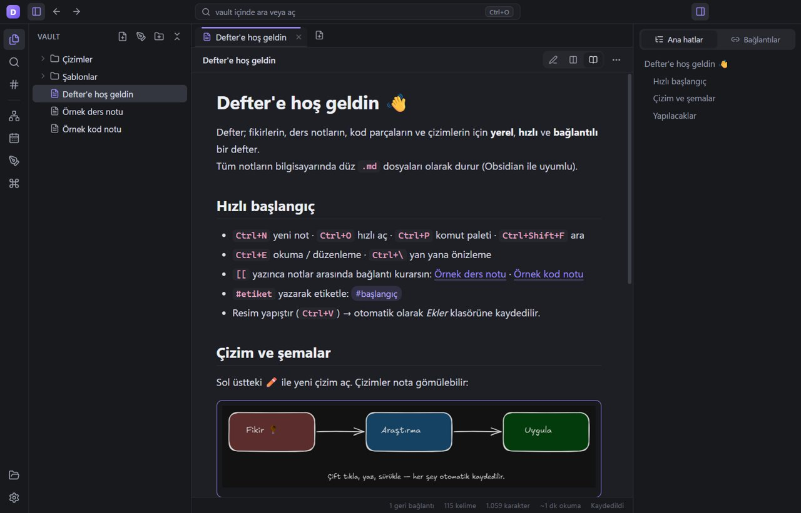
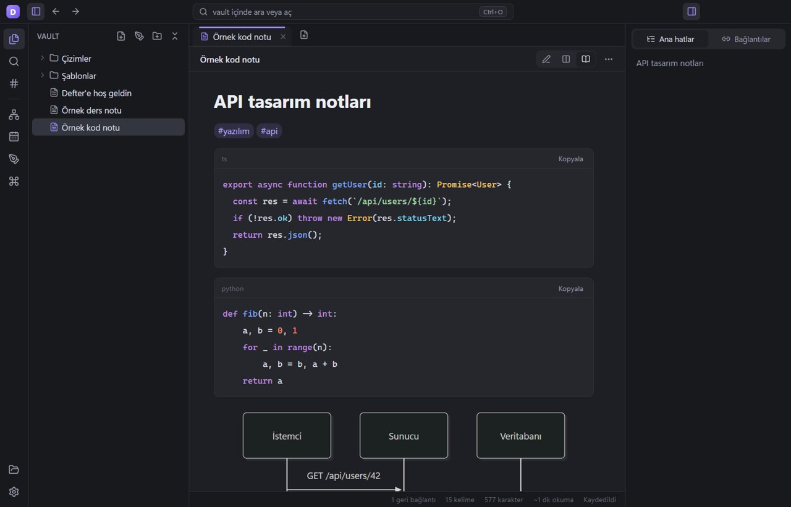
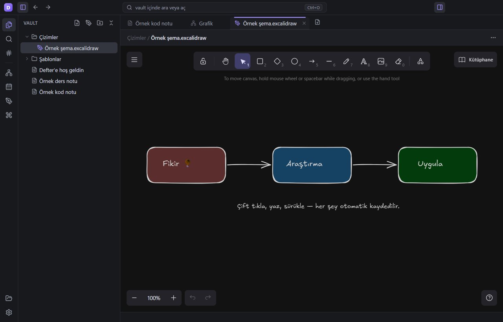
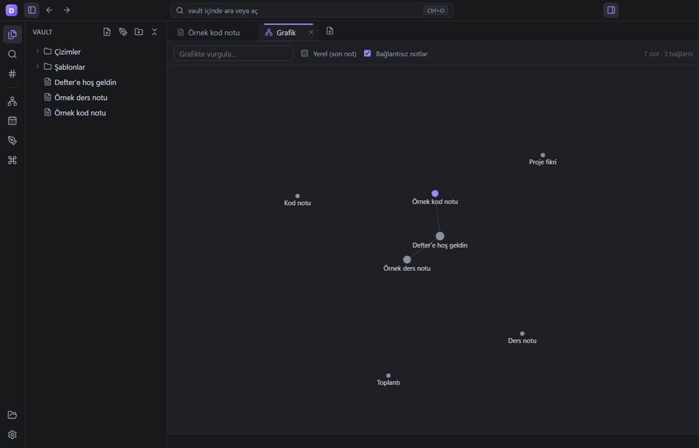
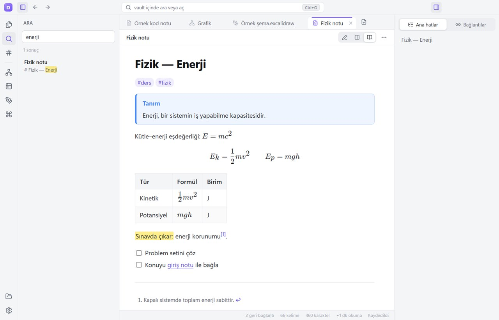

# Defter

Fikirlerin, ders notların, kod parçaların ve **çizimlerin** için Obsidian tarzı, yerel, hızlı ve bağlantılı bir defter (Windows).
Notlar bilgisayarında düz `.md` dosyaları olarak durur — Obsidian ile aynı klasörü açabilirsin, kilitlenme yok.



## Neler var

| | |
|---|---|
| **Markdown editörü** | CodeMirror 6; başlıklar/kalın/italik canlı biçimli, 100+ dilde kod renklendirme, otomatik liste devamı, bul-değiştir |
| **Düzenle / Yan yana / Oku** | `Ctrl+E` ile okuma, `Ctrl+\` ile canlı yan yana önizleme |
| **Bağlantılı notlar** | `[[Not]]`, `[[Not#Başlık]]`, `[[Not\|takma ad]]`, `![[gömme]]`; `[[` yazınca otomatik tamamlama; Ctrl+tık ile git |
| **Geri bağlantılar** | Sağ panel: bu nota kim bağlanıyor (bağlam satırıyla), giden ve henüz oluşturulmamış bağlantılar |
| **Grafik** | Tüm notların bağlantı haritası; sürükle, yakınlaştır, vurgula, "yerel grafik" |
| **Çizim ve şemalar** | Excalidraw ile serbest çizim, kutu-ok şemaları, el yazısı; `.excalidraw` dosyaları notlara `![[...]]` ile gömülür |
| **Kodla şema** | ` ```mermaid ` blokları: akış, sıra, sınıf, gantt, ER, zihin haritası… |
| **Ders için** | KaTeX matematik (`$...$`, `$$...$$`), tablolar, callout kutuları (`> [!note]`), görev listeleri, ==vurgu==, dipnot |
| **Düzen** | Klasörler, sürükle-bırak taşıma, `#etiket` paneli, günlük not, şablonlar (`{{title}}`, `{{date}}`) |
| **Arama** | Tüm notlarda bulanık tam metin arama (Türkçe karakter duyarsız), `#etiket` araması, hızlı açma (`Ctrl+O`), komut paleti (`Ctrl+P`) |
| **Resimler** | Yapıştır veya sürükle-bırak → otomatik `Ekler/` klasörüne kaydedilir ve nota eklenir |
| **Dışa aktarma** | PDF ve tek dosya HTML (şemalar ve resimler gömülü) |
| **Güvenli yeniden adlandırma** | Not adını değiştirince ona giden bütün bağlantılar otomatik güncellenir |
| **Görünüm** | Koyu / açık / Windows ile aynı tema, Windows 11 tarzı başlık çubuğu, yazı boyutu, yazım denetimi (TR+EN) |

<p>




</p>

## Kısayollar

| Kısayol | İş | Kısayol | İş |
|---|---|---|---|
| `Ctrl+N` | Yeni not | `Ctrl+Shift+N` | Yeni çizim |
| `Ctrl+O` | Hızlı aç | `Ctrl+P` | Komut paleti |
| `Ctrl+Shift+F` | Ara | `Ctrl+Shift+G` | Grafik |
| `Ctrl+E` | Okuma / düzenleme | `Ctrl+\` | Yan yana önizleme |
| `Ctrl+Alt+D` | Günlük not | `Ctrl+Alt+T` | Şablondan not |
| `Ctrl+B` / `Ctrl+I` | Kalın / italik | `Ctrl+K` | `[[bağlantı]]` |
| `Ctrl+Enter` | Görev kutusu | `Ctrl+H` | Başlık seviyesi |
| `Ctrl+Shift+H` | ==Vurgu== | `F2` | Yeniden adlandır |
| `Ctrl+W` | Sekmeyi kapat | `Ctrl+Tab` | Sonraki sekme |
| `Alt+←` / `Alt+→` | Geri / ileri | `Ctrl+,` | Ayarlar |

## Güvenlik ve performans

- İnternete bağlanmaz; yazı tipleri, şema ve çizim kütüphaneleri uygulamanın içinde gelir.
- Electron güvenlik önerileri uygulandı: `contextIsolation`, `sandbox`, `nodeIntegration` kapalı, sıkı CSP,
  uygulama sadece kendi `defter://` protokolünden yüklenir, sayfa dışına gezinme ve yeni pencere engelli.
- Dosya erişimi seçtiğin kasa klasörüyle sınırlıdır (yol kaçışı engellenir); silinen dosyalar Geri Dönüşüm Kutusu'na gider.
- Notlar atomik yazılır (önce geçici dosya, sonra yer değiştirme) ve pencere kapanırken kaydedilmemiş her şey diske yazılır.
- Mermaid, Excalidraw ve KaTeX gibi ağır parçalar sadece gerektiğinde yüklenir; grafik hareket bitince çizimi durdurur.
  Boşta işlemci kullanımı ~%0,2.
- Ayarlar `%APPDATA%\Defter\settings.json`, notlar varsayılan olarak `Belgeler\Defter` klasöründe.

## Geliştirme

Gereksinim: Node.js 22+

```bash
npm install
npm run dev        # derle ve çalıştır
npm run typecheck
npm run dist       # release/win-unpacked/Defter.exe
```

Otomatik uçtan uca test (gerçek pencerede gezer, ekran görüntüsü alır, kaydetmeyi doğrular):

```powershell
$env:DEFTER_USER_DATA="$env:TEMP\defter-test\data"; $env:DEFTER_VAULT="$env:TEMP\defter-test\vault"; $env:DEFTER_SMOKE="$env:TEMP\defter-test\shots"
npx electron .
```

**Kullanılan açık kaynak kütüphaneler:** Electron, React, CodeMirror 6, Excalidraw, Mermaid, KaTeX, markdown-it, highlight.js, MiniSearch, d3-force, DOMPurify, lucide.
